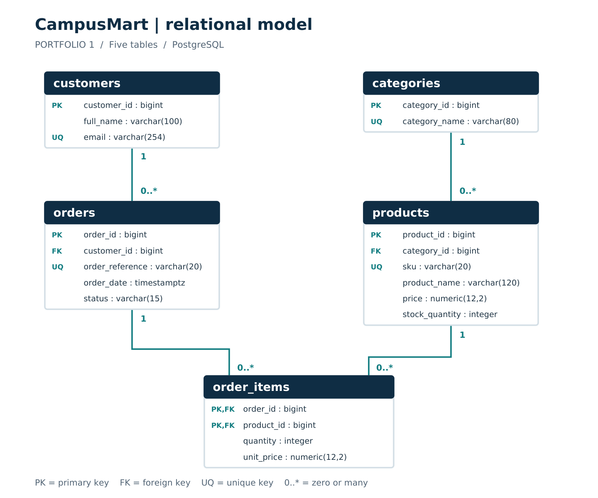

# Portfolio 1 Database Design and Modelling

Michael Olayemi Babalola | MIT 8103 Advanced Database Systems | 2026/2027 First Semester

## Case study and scope

CampusMart is a simulated Nigerian online retail business serving university students and staff. It sells electronics, books, clothing and accessories. Customers place orders, sales staff inspect order records, stock staff maintain product information, and administrators manage reference data. All records are fictional and prices are in Nigerian naira (NGN).

The database supports customer registration, product management, order recording and historical order-value reporting. The implementation contains five related tables. Payment processing, shipping, authentication and refunds are outside this scope.

## Relational schema

| Table | Primary key | Principal attributes |
|---|---|---|
| customers | customer_id | full_name; unique email |
| categories | category_id | unique category_name |
| products | product_id | category_id FK; unique sku; product_name; price; stock_quantity |
| orders | order_id | customer_id FK; unique order_reference; order_date; status |
| order_items | (order_id, product_id) | Both identifiers are FKs; quantity; unit_price |

## Integrity rules

Each order references one customer and each product references one category. Each order item references an order and a product. Foreign keys restrict deletion of referenced records. Primary and unique keys prevent duplicate identifiers, customer emails, SKUs, category names and order references. NOT NULL and CHECK constraints require valid names, statuses, quantities, stock and monetary values.

## Implementation and environment

I executed the schema, fictional seed data, verification queries and constraint checks in pgAdmin 4. The server query reports PostgreSQL 18.6 and database campusmart_portfolio. The submitted SQL files document that sequence, and seven screenshots record the desktop results.

## Entity relationship model

### First normal form

Each column holds one value for its domain. Multiple products in an order are represented by separate order_items rows, without repeated product columns or comma-separated lists.

### Second normal form

The four parent tables have single-column candidate keys. In order_items, quantity and charged unit_price depend on the complete (order_id, product_id) key. Product names depend on product_id alone and remain in products.

### Third normal form

Customer names and emails remain in customers; category names remain in categories. This avoids storing the transitive dependencies order_id -> customer_id -> customer details and product_id -> category_id -> category_name in one relation. The full dependencies appear in normalisation.md.

Current catalogue price and historical charged price are different facts. Order totals are derived from quantity multiplied by charged price.

## Verification results

| Table | Initial rows | Rows after checks |
|---|---|---|
| categories | 4 | 4 |
| customers | 6 | 6 |
| products | 10 | 10 |
| orders | 8 | 8 |
| order_items | 16 | 16 |

| No. | Invalid operation | Result |
|---|---|---|
| 1 | Duplicate customer email | PASS |
| 2 | Unknown customer on an order | PASS |
| 3 | Negative product stock | PASS |
| 4 | Zero order-item quantity | PASS |
| 5 | Negative current price | PASS |
| 6 | Missing customer name | PASS |
| 7 | Duplicate product line in one order | PASS |
| 8 | Unknown product category | PASS |
| 9 | Delete customer with historical orders | PASS |
| 10 | Invalid order status | PASS |
| 11 | Negative charged price | PASS |
| 12 | Blank product name | PASS |

## Evidence index

- [01-database-tables.png](../evidence/portfolio-1/screenshots/01-database-tables.png): The object browser lists categories, customers, order_items, orders and products.
- [02-row-counts.png](../evidence/portfolio-1/screenshots/02-row-counts.png): All five actual counts match the expected seed counts.
- [03-constraint-results.png](../evidence/portfolio-1/screenshots/03-constraint-results.png): All 12 tests show PASS, with expected and actual SQLSTATE values.
- [04-server-version.png](../evidence/portfolio-1/screenshots/04-server-version.png): campusmart_portfolio; server_version 18.6; pgAdmin 4 interface.
- [05-order-values.png](../evidence/portfolio-1/screenshots/05-order-values.png): Eight order values are displayed with customer names and order statuses.
- [06-historical-price.png](../evidence/portfolio-1/screenshots/06-historical-price.png): CM-1005 / BK001: current price NGN 18,000; charged price NGN 16,000.
- [07-counts-after-checks.png](../evidence/portfolio-1/screenshots/07-counts-after-checks.png): The same five counts remain after the constraint checks.

Supplementary CSV, JSON and log files retain the earlier automated PGlite validation; the seven screenshots document my desktop execution.

## Order values

| Order | Status | Value in NGN |
|---|---|---|
| CM-1001 | completed | 467,000.00 |
| CM-1002 | completed | 24,000.00 |
| CM-1003 | completed | 27,000.00 |
| CM-1004 | completed | 28,500.00 |
| CM-1005 | completed | 34,000.00 |
| CM-1006 | placed | 19,500.00 |
| CM-1007 | draft | 24,000.00 |
| CM-1008 | cancelled | 15,000.00 |

The displayed values include all statuses and are not sales revenue. CM-1005 retains BK001 at the charged price of NGN 16,000 rather than the current NGN 18,000; its order value is NGN 34,000.

## Technical reflection

The historical-price query provides a concrete reason for keeping `order_items.unit_price` separate from `products.price`. In CM-1005, the textbook was charged at NGN 16,000 even though its current price is NGN 18,000. Using the current catalogue price for past orders would alter the recorded value of the purchase.

The composite key in `order_items` gives each line a clear meaning: one product within one order. Quantity and charged price depend on both identifiers. Customer details and category names remain in their own tables, reducing repeated values and conflicting updates.

When capturing the constraint evidence, the successful execution message alone did not display the result table. The relevant evidence is the result grid produced by the SELECT on the temporary results table before the final ROLLBACK. The submitted screenshot shows all 12 PASS rows. The repeated count query then shows that the permanent table counts match their initial values.

These checks establish the tested integrity rules. They do not establish a complete ordering workflow. A foreign key validates an existing order item, but it does not require an order to contain an item. Minimum-item enforcement and atomic stock updates require transaction logic beyond this schema.

## AI use declaration

I used ChatGPT/Codex to assist with interpreting the assessment, developing the CampusMart schema and fictional sample data, preparing the ER diagram, SQL, report and repository documentation, and checking the scripts in an embedded PostgreSQL environment. I then ran the database work in PostgreSQL using pgAdmin 4 and captured the seven screenshots included in this submission. My screenshots show the table structure, row counts, 12 passing constraint checks, server version, order values, historical price and unchanged counts after testing.

## References

1. Miva Open University. (2026). MIT 8103 Advanced Database Systems: First Semester Continuous Assessment, 2026/2027 Academic Session.

2. PostgreSQL Global Development Group. Constraints. PostgreSQL 18 documentation. https://www.postgresql.org/docs/18/ddl-constraints.html

3. pgAdmin Development Team. Query Tool. https://www.pgadmin.org/docs/pgadmin4/latest/query_tool.html

4. Electric. PGlite documentation. https://pglite.dev/docs/
