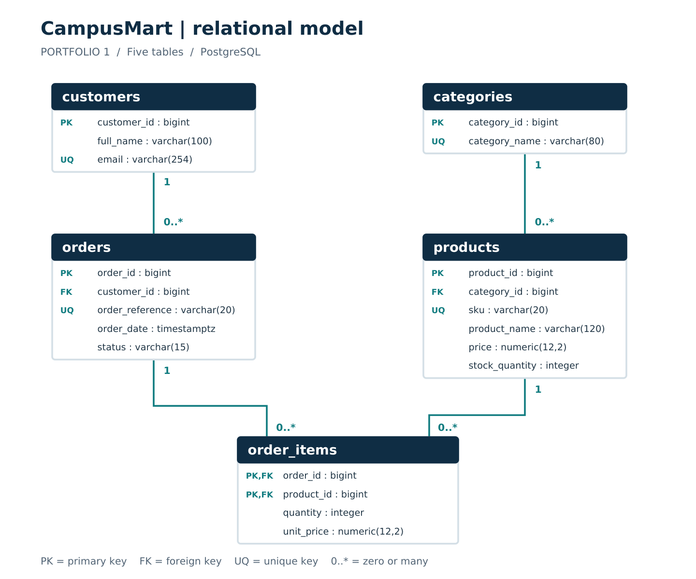

# Portfolio 1 - Database Design and Modelling

**Case study:** CampusMart  
**Marks:** 7  
**Implementation:** five PostgreSQL tables with keys, constraints and sample data

## Documentation

| Deliverable | File |
|---|---|
| Technical report | [PDF](../documentation/Portfolio-1-Report.pdf) · [Word](../documentation/Portfolio-1-Report.docx) |
| Organisation and business rules | [case-study.md](case-study.md) |
| ER diagram | [PNG](diagrams/campusmart-erd.png) · [PDF](diagrams/campusmart-erd.pdf) |
| Relational schema and column definitions | [data-dictionary.md](data-dictionary.md) |
| Normalisation | [normalisation.md](normalisation.md) |
| Source references | [references.md](references.md) |
| Recorded implementation results | [Evidence](../evidence/portfolio-1/README.md) |

## Database design

CampusMart sells electronics, books, clothing and accessories. Its database
supports customer registration, product management, recording orders and their
items, and historical order-value reporting. All data is fictional; amounts are NGN.

The five relations are CUSTOMERS, CATEGORIES, PRODUCTS, ORDERS and ORDER_ITEMS.
ORDER_ITEMS resolves the many-to-many relationship between orders and products.
Its composite primary key permits a product to appear only once in a given order.
Historical `unit_price` is retained separately from a product's current `price`.

## Execute the implementation

Use a new, empty database named `campusmart_portfolio`. Open Query Tool on that
database, not the maintenance database `postgres`.

| Order | File | How to execute | Expected outcome |
|---:|---|---|---|
| 1 | [01_schema.sql](sql/01_schema.sql) | Whole script | Five tables created |
| 2 | [02_seed_data.sql](sql/02_seed_data.sql) | Whole script, once | Fictional sample data inserted |
| 3 | [03_verify_data.sql](sql/03_verify_data.sql) | Each numbered SELECT separately | Counts, values, prices and implemented rules |
| 4 | [04_constraint_checks.sql](sql/04_constraint_checks.sql) | Whole script | 12 PASS rows; permanent data unchanged |

For whole files use **Execute script** with no partial selection. Begin with no
unfinished transaction. If a script unexpectedly fails, retain the error, run
`ROLLBACK;` to clear an aborted transaction and correct the underlying cause.
Do not rerun schema creation or seed loading to hide an error. Use a fresh test
database when you intentionally need to repeat the setup.

Expected counts: **6 customers, 4 categories, 10 products, 8 orders, 16 order items**.

## Integrity and normalisation

- Primary and alternate keys prevent duplicate identities, emails, SKUs and order references.
- Foreign keys require existing customers, categories, orders and products.
- CHECK constraints restrict status, stock, prices and quantities.
- NOT NULL constraints require essential values.
- ON DELETE RESTRICT preserves referenced parent rows.
- 1NF removes repeating item groups; 2NF retains whole-key facts in ORDER_ITEMS;
  3NF separates customer and category details from dependent records.

See the normalisation document for functional dependencies and concrete examples.

## Validation and boundaries

All four scripts have been executed in embedded PostgreSQL 18.3 (PGlite 0.5.8).
The evidence directory contains actual captured results, not sample screenshots.
All five counts and 12 rejection checks pass, eight order amounts match the
expected values, and the second seed load is rejected. The desktop installation
and pgAdmin execution have not been independently verified.

Draft orders can have no items. Requiring an item before placement and changing
stock atomically are future transaction-workflow tasks for Portfolio 3. The
query that detects empty placed orders is not itself an enforcement constraint.
Initial stock is a current snapshot, not a replayed stock ledger. Order values
including draft/cancelled statuses must not be labelled realised revenue.

## Outstanding student evidence

Add your own readable PostgreSQL/pgAdmin screenshots of the database, the row
counts and the constraint-check results. The colleague's supplied GitHub images
do not demonstrate those operations and are excluded from this repository.
Review the report and reflection, and record your actual verification in the
AI-use declaration before submission.
